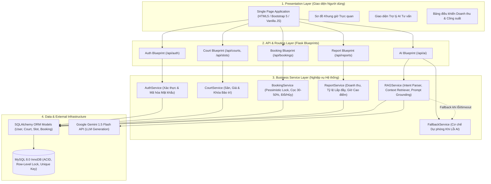
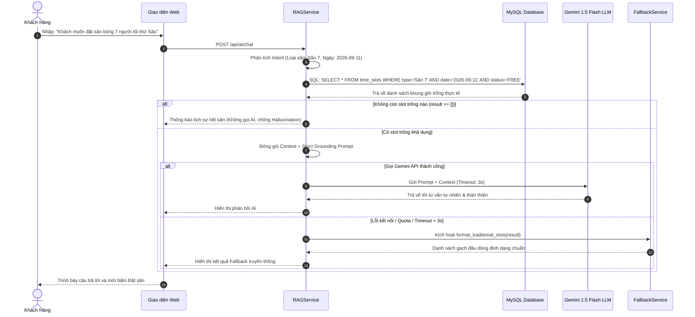
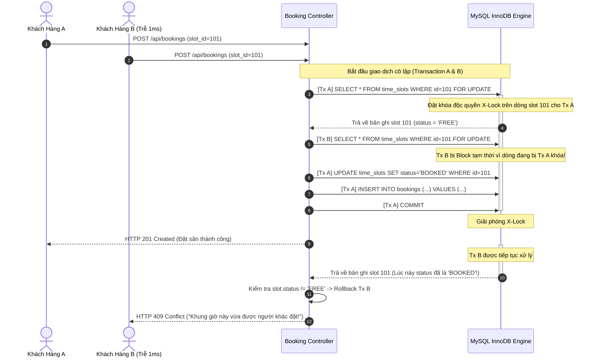

# Tài Liệu Thiết Kế Kiến Trúc Hệ Thống (Architecture Design Document)
## Hệ Thống Quản Lý Sân Thể Thao Tích Hợp AI (Đề Tài 36)

Tài liệu này đặc tả kiến trúc tổng thể, mô hình phân lớp (Layered Architecture), luồng dữ liệu của Pipeline AI RAG và cơ chế kiểm soát đồng thời (Concurrency Control) của hệ thống SportSync AI.

---

## 1. Mô Hình Kiến Trúc Phân Lớp (Layered Architecture)

Hệ thống được thiết kế theo mô hình 4 tầng phân lập rõ ràng (Separation of Concerns), đảm bảo tính module hóa, dễ bảo trì và mở rộng:

---

## 2. Luồng Xử Lý Pipeline AI RAG & Dự Phòng (Fallback Sequence)

Mô hình RAG (Retrieval-Augmented Generation) kết hợp cơ chế Chịu lỗi (NFR-08) đảm bảo hệ thống phản hồi thông minh nhưng không bao giờ bị gián đoạn:

---

## 3. Luồng Xử Lý Tranh Chấp Đặt Sân (Concurrency Pessimistic Locking)

Cơ chế khóa bi quan loại bỏ hoàn toàn nguy cơ 2 khách hàng đặt đè lên cùng 1 khung giờ:

---

## 4. Các Thành Phần Trọng Yếu & Quyết Định Kỹ Thuật

| Thành Phần | Công Nghệ Lựa Chọn | Lý Do & Giá Trị Kỹ Thuật |
| :--- | :--- | :--- |
| **Backend Framework** | Python Flask 3.0 | Nhẹ, linh hoạt, khởi động nhanh, tích hợp mượt mà với thư viện AI `google-genai` và ORM `Flask-SQLAlchemy`. |
| **Database Engine** | MySQL 8.0 (InnoDB) | Đảm bảo tính toàn vẹn ACID, hỗ trợ khóa dòng độc quyền `FOR UPDATE` và kiểm tra khóa ràng buộc `UNIQUE KEY`. |
| **Generative AI** | Google Gemini 1.5 Flash | Tốc độ sinh phản hồi cực nhanh (< 2s), chi phí tối ưu, cửa sổ ngữ cảnh lớn, hỗ trợ tiếng Việt xuất sắc. |
| **Kiến trúc Khả năng Chịu lỗi** | 2-Tier Fallback | Độc lập hoàn toàn với Cloud AI bên ngoài khi gặp sự cố, giữ vững hoạt động kinh doanh của quầy lễ tân. |

