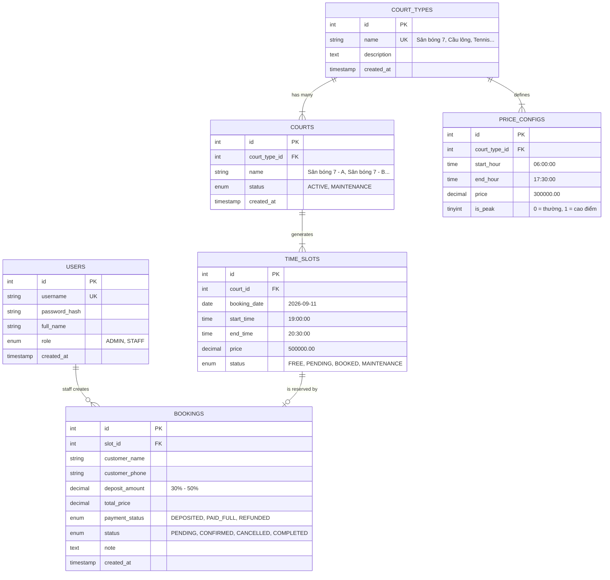

# Tài Liệu Thiết Kế Cơ Sở Dữ Liệu (Database Design Document)
## Hệ Thống Quản Lý Sân Thể Thao Tích Hợp AI (Đề Tài 36)

Tài liệu này chi tiết hóa thiết kế Schema CSDL MySQL đạt chuẩn chuẩn hóa **3NF (Third Normal Form)**, từ điển dữ liệu (Data Dictionary), sơ đồ thực thể liên kết (ERD) và chiến lược tối ưu hóa chỉ mục (Indexes).

---

## 1. Sơ Đồ Thực Thể - Liên Kết (Entity-Relationship Diagram - ERD)



---

## 2. Chứng Minh Chuẩn Hóa CSDL Đạt Chuẩn 3NF

1. **Chuẩn 1 (1NF - First Normal Form)**:
   - Tất cả các trường dữ liệu đều là nguyên tử (Atomic values), không chứa mảng hay chuỗi lồng nhau (ví dụ: ngày và giờ bắt đầu/kết thúc được tách riêng thành kiểu `DATE` và `TIME`).
   - Mỗi bảng đều có Khóa chính duy nhất (`id AUTO_INCREMENT PRIMARY KEY`).
2. **Chuẩn 2 (2NF - Second Normal Form)**:
   - Đạt chuẩn 1NF.
   - Toàn bộ các thuộc tính phi khóa đều phụ thuộc hàm đầy đủ vào khóa chính. Bảng `price_configs` và `time_slots` được tách rời khỏi bảng `courts` để tránh phụ thuộc một phần.
3. **Chuẩn 3 (3NF - Third Normal Form)**:
   - Đạt chuẩn 2NF.
   - Không tồn tại phụ thuộc bắc cầu (Transitive Dependency). Ví dụ: Loại sân (`court_types`) được tách thành bảng độc lập thay vì lưu tên loại sân trực tiếp trong `courts`, giúp việc sửa đổi tên loại sân hoặc bảng giá không dẫn đến dư thừa hoặc dị thường cập nhật (Update Anomalies).

---

## 3. Từ Điển Dữ Liệu Chi Tiết (Data Dictionary)

### 3.1. Bảng `users` (Người dùng & Phân quyền)
| Tên Cột | Kiểu Dữ Liệu | Ràng Buộc | Ý Nghĩa / Mục Đích |
| :--- | :--- | :--- | :--- |
| `id` | `INT` | `PK, AUTO_INCREMENT` | Định danh duy nhất người dùng |
| `username` | `VARCHAR(50)` | `NOT NULL, UNIQUE` | Tên đăng nhập tài khoản |
| `password_hash` | `VARCHAR(255)` | `NOT NULL` | Chuỗi mã hóa mật khẩu bảo mật (PBKDF2/BCrypt) |
| `full_name` | `VARCHAR(100)` | `NOT NULL` | Họ và tên nhân viên hoặc quản lý |
| `role` | `ENUM('ADMIN','STAFF')` | `NOT NULL, DEFAULT 'STAFF'` | Vai trò phân quyền trong hệ thống |
| `created_at` | `TIMESTAMP` | `DEFAULT CURRENT_TIMESTAMP` | Thời điểm tạo tài khoản |

### 3.2. Bảng `court_types` (Loại sân)
| Tên Cột | Kiểu Dữ Liệu | Ràng Buộc | Ý Nghĩa / Mục Đích |
| :--- | :--- | :--- | :--- |
| `id` | `INT` | `PK, AUTO_INCREMENT` | Mã định danh loại sân |
| `name` | `VARCHAR(100)` | `NOT NULL, UNIQUE` | Tên loại sân (Sân bóng 7, Cầu lông, Tennis) |
| `description` | `TEXT` | `NULL` | Mô tả đặc tính mặt sân |
| `created_at` | `TIMESTAMP` | `DEFAULT CURRENT_TIMESTAMP` | Thời điểm tạo |

### 3.3. Bảng `courts` (Danh mục sân thực tế)
| Tên Cột | Kiểu Dữ Liệu | Ràng Buộc | Ý Nghĩa / Mục Đích |
| :--- | :--- | :--- | :--- |
| `id` | `INT` | `PK, AUTO_INCREMENT` | Mã định danh sân |
| `court_type_id` | `INT` | `NOT NULL, FK` | Tham chiếu tới `court_types(id)` ON DELETE CASCADE |
| `name` | `VARCHAR(100)` | `NOT NULL` | Tên sân (Ví dụ: Sân bóng 7 - A) |
| `status` | `ENUM('ACTIVE','MAINTENANCE')`| `DEFAULT 'ACTIVE'` | Trạng thái hoạt động hoặc đang bảo trì |
| `created_at` | `TIMESTAMP` | `DEFAULT CURRENT_TIMESTAMP` | Thời điểm tạo |

### 3.4. Bảng `price_configs` (Cấu hình giá giờ cao/thấp điểm)
| Tên Cột | Kiểu Dữ Liệu | Ràng Buộc | Ý Nghĩa / Mục Đích |
| :--- | :--- | :--- | :--- |
| `id` | `INT` | `PK, AUTO_INCREMENT` | Mã cấu hình giá |
| `court_type_id` | `INT` | `NOT NULL, FK` | Tham chiếu `court_types(id)` ON DELETE CASCADE |
| `start_hour` | `TIME` | `NOT NULL` | Giờ bắt đầu áp dụng |
| `end_hour` | `TIME` | `NOT NULL` | Giờ kết thúc áp dụng |
| `price` | `DECIMAL(12, 2)` | `NOT NULL` | Đơn giá thuê sân / slot (VNĐ) |
| `is_peak` | `TINYINT(1)` | `DEFAULT 0` | 1 = Khung giờ cao điểm; 0 = Khung giờ thường |

### 3.5. Bảng `time_slots` (Khung giờ & Chống trùng lịch)
| Tên Cột | Kiểu Dữ Liệu | Ràng Buộc | Ý Nghĩa / Mục Đích |
| :--- | :--- | :--- | :--- |
| `id` | `INT` | `PK, AUTO_INCREMENT` | Mã định danh khung giờ |
| `court_id` | `INT` | `NOT NULL, FK` | Tham chiếu `courts(id)` ON DELETE CASCADE |
| `booking_date` | `DATE` | `NOT NULL` | Ngày thi đấu (YYYY-MM-DD) |
| `start_time` | `TIME` | `NOT NULL` | Giờ bắt đầu (HH:MM:SS) |
| `end_time` | `TIME` | `NOT NULL` | Giờ kết thúc (HH:MM:SS) |
| `price` | `DECIMAL(12, 2)` | `NOT NULL` | Giá thuê của khung giờ này |
| `status` | `ENUM('FREE','PENDING','BOOKED','MAINTENANCE')` | `DEFAULT 'FREE'` | Trạng thái đặt của khung giờ |
| **uq_court_slot** | **UNIQUE KEY** | **`(court_id, booking_date, start_time)`** | **Ràng buộc chống trùng lịch cấp CSDL** |

### 3.6. Bảng `bookings` (Đơn đặt sân & Tiền cọc)
| Tên Cột | Kiểu Dữ Liệu | Ràng Buộc | Ý Nghĩa / Mục Đích |
| :--- | :--- | :--- | :--- |
| `id` | `INT` | `PK, AUTO_INCREMENT` | Mã đơn đặt sân |
| `slot_id` | `INT` | `NOT NULL, FK` | Tham chiếu `time_slots(id)` ON DELETE CASCADE |
| `customer_name` | `VARCHAR(100)` | `NOT NULL` | Tên khách hàng đặt sân |
| `customer_phone`| `VARCHAR(20)` | `NOT NULL` | Số điện thoại liên hệ |
| `deposit_amount`| `DECIMAL(12, 2)` | `NOT NULL` | Số tiền cọc đã thu (30% - 50%) |
| `total_price` | `DECIMAL(12, 2)` | `NOT NULL` | Tổng số tiền thuê sân |
| `payment_status`| `ENUM('DEPOSITED','PAID_FULL','REFUNDED')` | `DEFAULT 'DEPOSITED'` | Trạng thái thanh toán |
| `status` | `ENUM('PENDING','CONFIRMED','CANCELLED','COMPLETED')` | `DEFAULT 'CONFIRMED'` | Trạng thái đơn đặt |
| `note` | `TEXT` | `NULL` | Ghi chú yêu cầu thêm hoặc lý do đổi/hủy |
| `created_at` | `TIMESTAMP` | `DEFAULT CURRENT_TIMESTAMP` | Thời điểm tạo đơn |

---

## 4. Chiến Lược Đánh Chỉ Mục (Indexing Strategy)

Để đảm bảo tốc độ phản hồi < 100ms cho các truy vấn tra cứu lịch và phục vụ RAG Retriever thời gian thực:
1. **`uq_court_slot (court_id, booking_date, start_time)`**: Khóa UNIQUE kép đóng 2 vai trò: vừa làm Unique Index vừa ngăn ngừa triệt để 2 bản ghi slot trùng nhau.
2. **`idx_slot_query (booking_date, status)`**: Tối ưu hóa cực mạnh cho truy vấn tìm kiếm slot trống của AI RAG:
   ```sql
   SELECT ... FROM time_slots WHERE booking_date = '2026-09-11' AND status = 'FREE';
   ```
3. **`idx_slot_court_date (court_id, booking_date)`**: Tối ưu hóa hiển thị sơ đồ ma trận khung giờ trên giao diện Web.
4. **`idx_booking_phone (customer_phone)`**: Giúp tra cứu lịch sử đặt sân của từng khách hàng nhanh chóng khi khách đọc số điện thoại.
5. **`idx_court_status (status)`**: Tối ưu hóa việc lọc các sân đang bảo trì.

