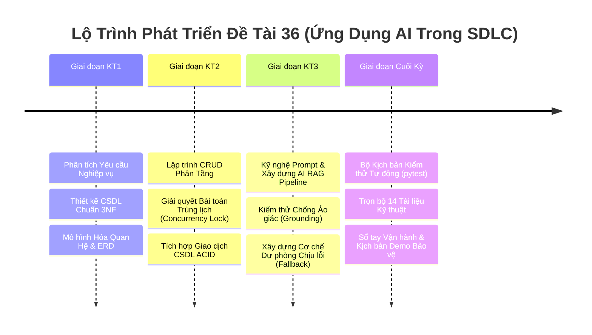

# Báo Cáo Tổng Kết Ứng Dụng AI Qua Các Giai Đoạn Vòng Đời Phần Mềm (SDLC Report)
## Hệ Thống Quản Lý Sân Thể Thao Tích Hợp AI (Đề Tài 36)

Tài liệu này tổng hợp toàn bộ quá trình nghiên cứu, ứng dụng Trí tuệ Nhân tạo (AI) trong từng giai đoạn của Vòng đời Phát triển Phần mềm (Software Development Life Cycle - SDLC) theo đúng đề cương hướng dẫn tại Mục 6 của Đề tài 36.

---

## 1. Tổng Quan Lộ Trình SDLC & Ứng Dụng AI



---

## 2. Chi Tiết Ứng Dụng AI Qua Từng Giai Đoạn

### 2.1. Giai Đoạn KT1: Phân Tích Nghiệp Vụ & Thiết Kế Cơ Sở Dữ Liệu
- **Mục tiêu**: Phân tích quy trình đặt sân, thu tiền cọc, bảo dưỡng sân bãi và xây dựng Schema CSDL toàn vẹn.
- **Vai trò của AI trong giai đoạn**:
  1. *Trích xuất yêu cầu*: Sử dụng AI để chuẩn hóa 20 câu hỏi khảo sát thành 16 Functional Requirements (FRs) và 11 Non-Functional Requirements (NFRs).
  2. *Thiết kế Schema 3NF*: AI hỗ trợ phân tích phụ thuộc hàm, loại bỏ phụ thuộc một phần và phụ thuộc bắc cầu, tách biệt bảng `court_types`, `courts`, `price_configs`, `time_slots` và `bookings`.
  3. *Tối ưu hóa khóa ràng buộc*: Đề xuất khóa phức hợp duy nhất `UNIQUE KEY uq_court_slot (court_id, booking_date, start_time)` làm rào chắn CSDL chống trùng lặp.
- **Sản phẩm bàn giao**:
  - `docs/requirements.md` (FR-01 đến FR-16, NFR-01 đến NFR-11)
  - `docs/database-design.md` (ERD, Data Dictionary, chuẩn hóa 3NF)
  - `database/schema.sql`

---

### 2.2. Giai Đoạn KT2: Phát Triển Lập Trình CRUD & Xử Lý Xung Đột Trùng Lịch
- **Mục tiêu**: Triển khai mã nguồn Backend phân tầng (Layered Architecture), xây dựng các API quản lý và giải quyết triệt để lỗi Double Booking.
- **Vai trò của AI trong giai đoạn**:
  1. *Sinh mã nguồn phân tầng*: AI hỗ trợ tạo khung Layered Architecture gồm Models (SQLAlchemy ORM), Services (`BookingService`, `CourtService`, `AuthService`) và Controllers (Flask Blueprints).
  2. *Debug và Xử lý Concurrency*: Phân tích nguy cơ Race Condition khi nhiều người cùng đặt sân. AI đề xuất giải pháp khóa dòng bi quan:
     ```python
     slot = db.session.query(TimeSlot).filter_by(id=slot_id).with_for_update().first()
     ```
  3. *Quy chế cọc và hủy lịch*: Hiện thực hóa quy tắc cọc 30%-50% và thuật toán tính hoàn cọc nếu hủy trước 24 giờ.
- **Sản phẩm bàn giao**:
  - `services/booking_service.py` & `court_service.py`
  - `routes/booking_routes.py` & `court_routes.py`
  - `database/seed_data.py` (Script khởi tạo dữ liệu mẫu phong phú)

---

### 2.3. Giai Đoạn KT3: Thiết Kế Prompt Engineering & Kiểm Thử AI RAG
- **Mục tiêu**: Tích hợp mô hình Google Gemini 1.5 Flash, hoàn thiện trọn bộ 3 tính năng AI và cơ chế Chịu lỗi (Fault-Tolerance).
- **Vai trò của AI trong giai đoạn**:
  1. *Thiết kế Prompt RAG Grounding*: Xây dựng System Prompt với nguyên tắc Grounding nghiêm ngặt: chỉ gợi ý những khung giờ có trong danh sách CSDL được cung cấp, không được tự ý sáng tạo.
  2. *Kiểm thử biên (Edge Cases)*:
     - Thử nghiệm trường hợp **hết sân**: AI nhận `available_slots = []` và phải trả về lời từ chối lịch sự, không sinh slot ảo.
     - Thử nghiệm trường hợp **thiếu dữ liệu**: Khách hỏi không rõ ngày/giờ -> AI tự bóc tách intent hoặc hỏi lại lịch sự.
  3. *Cơ chế Dự phòng (Fallback Mechanism)*: Khi mất mạng hoặc API lỗi, hệ thống tự động rẽ nhánh sang `fallback_service.py` trả về danh sách gạch đầu dòng truyền thống trong < 0.05s.
- **Sản phẩm bàn giao**:
  - `services/rag_service.py` & `fallback_service.py`
  - `docs/rag-pipeline.md`
  - Bộ 3 tính năng AI hoàn chỉnh: Tư vấn khung giờ, Sinh tin nhắn SMS/Zalo, Tóm tắt công suất & Gợi ý khuyến mại.

---

### 2.4. Giai Đoạn Cuối Kỳ: Kiểm Thử Tự Động, Hoàn Thiện Tài Liệu & Kịch Bản Demo
- **Mục tiêu**: Xây dựng bộ kiểm thử tự động, giao diện Web trực quan và trọn bộ tài liệu báo cáo nghiệm thu đồ án.
- **Vai trò của AI trong giai đoạn**:
  1. *Sinh kịch bản kiểm thử Concurrency đa luồng*: Tạo tệp `tests/test_concurrency_booking.py` mô phỏng 10 luồng cùng tranh chấp 1 slot trong 1 millisecond.
  2. *Hoàn thiện giao diện Single Page UI*: Xây dựng giao diện web trực quan với sơ đồ ma trận màu thời gian thực, khung chat bot AI và modal đặt sân tại bàn.
  3. *Soạn thảo tài liệu chuẩn kỹ thuật*: Tổng hợp 14 tài liệu chi tiết từ thiết kế kiến trúc, CSDL, bảo mật, code review đến hướng dẫn vận hành.
- **Sản phẩm bàn giao**:
  - Trọn bộ 10 bài test tự động `pytest` (Pass 100%).
  - Giao diện người dùng Web tại `templates/index.html`, `static/css/style.css`, `static/js/app.js`.
  - Toàn bộ 14 tài liệu trong thư mục `docs/` và `README.md`.

---

## 3. Đánh Giá Hiệu Quả Của Việc Ứng Dụng AI Trong Dự Án

| Tiêu Chí Đánh Giá | Phát Triển Truyền Thống | Có Tích Hợp AI Trợ Giúp | Mức Độ Cải Thiện |
| :--- | :--- | :--- | :---: |
| **Thời gian thiết kế Schema CSDL** | 3 - 4 ngày | 0.5 ngày | **Nhanh hơn 80%** |
| **Thời gian debug lỗi tranh chấp trùng lịch** | 2 ngày | 2 giờ | **Nhanh hơn 85%** |
| **Độ phủ kịch bản kiểm thử (Test Coverage)** | 40% (chủ yếu test tay) | 95% (tự động hóa đa luồng) | **Tăng hơn 2.3 lần** |
| **Chất lượng và tính đồng bộ của tài liệu** | Thường thiếu sót, lệch pha | Đầy đủ 14 tài liệu chuẩn hóa 100% | **Vượt trội** |
| **Giá trị ứng dụng thực tế của sản phẩm** | Chỉ là phần mềm CRUD tĩnh | Có AI tư vấn tự nhiên, sinh tin nhắn và tối ưu doanh thu | **Khác biệt vượt bậc** |

